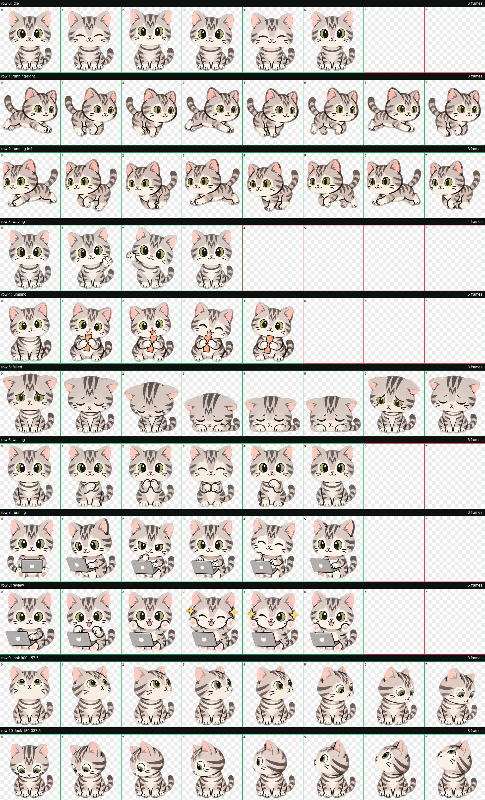
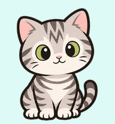
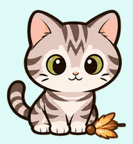

# Oz — a custom ChatGPT Pet

Oz (오즈) is a round, cartoon-style silver tabby companion made for ChatGPT Work's Pets experience. Oz works on a laptop, celebrates completed work, looks adorably dejected after failure, and reacts to hover with a snack or feather toy.



## Choose a version

### Churu version (recommended)

Oz eats churu when the hover/jump interaction is triggered.
This version uses the refined outer-outline treatment: 10% stroke thickness
at 25% opacity, while preserving the original tabby markings, facial details,
props, paws, and toe lines.



Download [`assets/oz-churu.png`](assets/oz-churu.png).

### Feather-toy version

Oz taps and plays with a feather toy when the hover/jump interaction is triggered.



Download [`assets/oz-feather.png`](assets/oz-feather.png).

## Add Oz to ChatGPT

You need access to ChatGPT Work and the Pets app/plugin.

1. Download one of the sprite sheets above.
2. Open ChatGPT Work and invoke **Pets**.
3. Attach the downloaded PNG and ask:

   > Create a custom pet named Oz using this validated v2 sprite sheet, then select it as my active pet.

Each person creates their own custom-pet record. The original owner's internal pet ID is intentionally not used for distribution.

## 한국어 사용 방법

ChatGPT Work와 Pets 앱/플러그인을 사용할 수 있어야 합니다.

1. 위에서 원하는 스프라이트 시트 PNG를 내려받습니다.
2. ChatGPT Work에서 **Pets**를 호출합니다.
3. 내려받은 PNG를 첨부하고 다음과 같이 요청합니다.

   > 첨부한 검증 완료 v2 스프라이트 시트로 `오즈`라는 커스텀 펫을 만들고 활성 펫으로 선택해줘.

각 사용자의 계정에 별도의 커스텀 펫으로 등록됩니다. 원본 제작자의 내부 펫 ID를 공유하거나 재사용하지 않습니다.

## Sprite-sheet format

- PNG with transparency
- 1536 × 2288 pixels
- v2 layout: 8 columns × 11 rows
- Cell size: 192 × 208 pixels
- Both published variants pass the ChatGPT Pets structural validator
- Row 4 is intentionally customized as the hover reaction, so clients that also use this row for jumping will show the same reaction

Validation reports are included in [`docs/`](docs/).

## Files

```text
assets/
  oz-churu.png            Default public sprite sheet
  oz-feather.png          Alternate feather-toy sprite sheet
previews/
  churu.gif
  feather.gif
  contact-sheet.png
docs/
  churu-validation.json
  feather-validation.json
```

## Credits

Oz was designed from the creator's American Shorthair cat and iterated collaboratively with OpenAI image-generation and ChatGPT Pets tooling.

## License

Oz's artwork, sprite sheets, and previews are available under
[CC BY-NC 4.0](LICENSE). You may share and adapt them for non-commercial use
with attribution. Commercial use is not permitted without separate permission.
